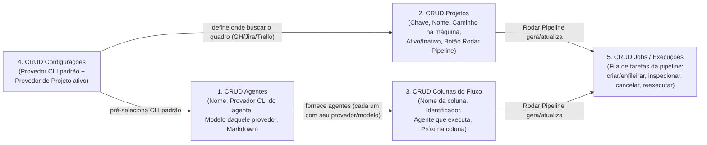
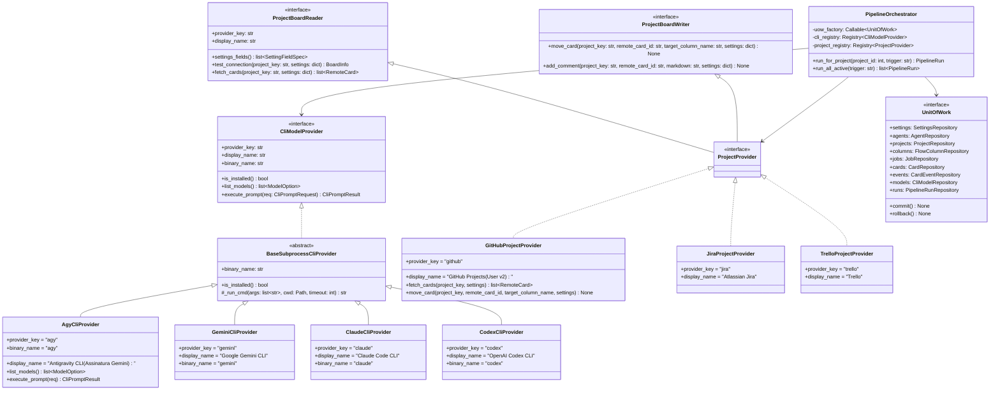
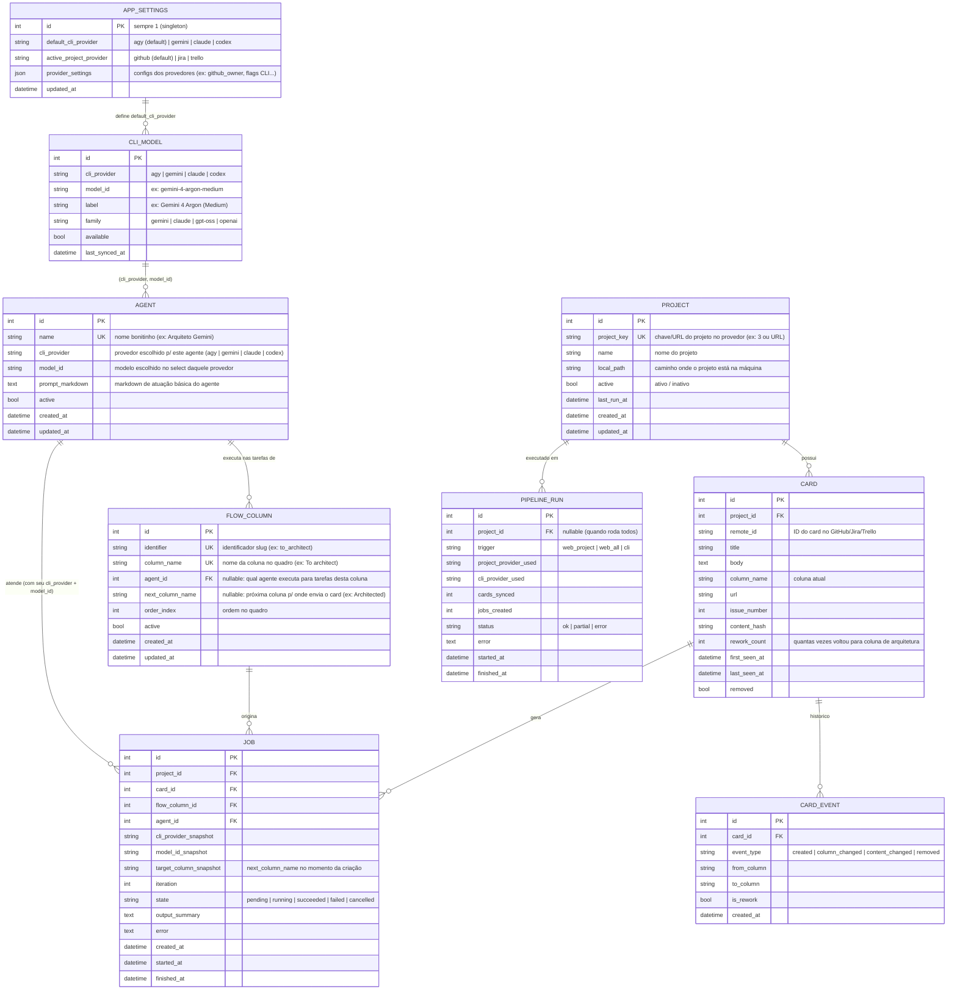
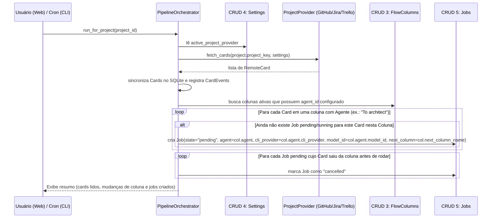

# Pipeline de Desenvolvimento Automático com IA — Arquitetura Final (Open Source & SOLID)

> Documento de planejamento e estudo de viabilidade.
> **Foco desta versão:** estrutura final pensada para **Open Source**, baseada nos princípios **SOLID (Ports & Adapters)**, onde **provedores de CLI de IA** e **provedores de projetos (GitHub, Jira, Trello)** são classes plugáveis via Pull Request e selecionáveis globalmente em um **CRUD de Configurações**, governando **5 CRUDs principais** (Agentes, Projetos, Colunas/Fluxo, Configurações e Execuções/Jobs).

---

## 1. Estudo de Viabilidade Técnica

Fiz a inspeção do seu ambiente Linux e validei os 4 pilares do pedido:

### 1.1 Provedores de IA baseados exclusivamente em CLIs instaladas na máquina
Inspecionei o `$PATH` da sua máquina e encontrei **4 CLIs de IA instaladas**:
- `agy` (`/home/maurelio/.local/bin/agy`) — **Antigravity CLI (sua assinatura Gemini)**. Suporta `agy models` (lista modelos dinamicamente) e `agy --print "<prompt>" --model <id> --output-format json`.
- `gemini` (`/home/maurelio/.nvm/versions/node/v24.6.0/bin/gemini`) — **Gemini CLI**. Suporta `-p/--prompt` (headless) e `-m/--model`.
- `claude` (`/home/maurelio/.local/bin/claude`) — **Claude Code CLI**.
- `codex` (`/home/maurelio/.local/bin/codex`) — **OpenAI Codex CLI**.

**Conclusão de viabilidade:** Totalmente viável. Criamos o contrato `CliModelProvider`. Cada CLI é uma classe Python isolada em `src/pipeline/adapters/cli_providers/`. O método `is_installed()` usa `shutil.which(binary_name)` para detectar se o binário existe na máquina. No **CRUD 1 (Agentes)**, ao criar ou editar um agente, você escolhe **qual Provedor CLI** aquele agente vai usar (ex.: Agente X usando `agy` e Agente Z usando `claude` ou `gemini`) e o `<select>` de modelos carrega dinamicamente via HTMX os modelos daquele provedor. No **CRUD 4 (Configurações)**, você define o Provedor CLI padrão (pré-selecionado ao abrir o formulário de novo agente) e pode sincronizar/testar todos os provedores CLI instalados. Para a comunidade Open Source adicionar outra CLI (ex.: `ollama`, `aider`, `qwen`), basta abrir um PR com uma nova classe implementando `CliModelProvider`.

### 1.2 Provedores de Projetos (GitHub Projects, Jira, Trello)
- Na arquitetura anterior o vínculo do projeto ainda carregava detalhes de URL. Agora, como o **Provedor de Projeto Ativo** (`github`, `jira` ou `trello`) é escolhido no **CRUD de Configurações**, o **CRUD de Projetos** fica 100% limpo e padronizado: guarda apenas **Nome do Projeto**, **Chave do Projeto (`project_key`)**, **Caminho na Máquina (`local_path`)** e **Ativo/Inativo** (com o botão **"Rodar Pipeline"**).
- Como cada provedor interpreta `project_key`:
  - **`GitHubProjectProvider`** (`github`): aceita o número do projeto do usuário configurado (ex.: `3`), `login/3` ou a URL completa `https://github.com/users/LOGIN/projects/3`.
  - **`JiraBoardProvider`** (`jira`): interpreta `project_key` como a chave do projeto/board no Jira (ex.: `PIP` ou `PIP:42`).
  - **`TrelloBoardProvider`** (`trello`): interpreta `project_key` como o `shortLink` ou `id` do quadro do Trello (ex.: `b8x9Lm2p`).

### 1.3 Colunas e Fluxo 100% dinâmicos via CRUD (sem estágios fixos no código)
- Em vez de travar `To architect -> Architected` no código, o **CRUD 3 (Colunas do Fluxo / Etapas)** permite cadastrar qualquer coluna do quadro:
  - **Nome da Coluna** (`column_name`, ex.: `To architect`)
  - **Identificador** (`identifier` / slug único, ex.: `to_architect`)
  - **Agente Responsável** (`agent_id` — opcional: se preenchido, quando um card entra nessa coluna esse agente é acionado; se vazio, é uma coluna de espera/ação humana, como `Todo`, `Architected`, `Homolog`, `Done`)
  - **Próxima Coluna** (`next_column_name`, ex.: `Architected` — para onde o card será enviado após o agente concluir)
- **Conclusão de viabilidade:** Isso elimina qualquer `enum` fixo de colunas no código. O usuário monta seu próprio Kanban pela interface web!

---

## 2. Os 5 CRUDs Principais (+ Auxiliares)

Você pediu especificamente **4 CRUDs de negócio** dentro de uma estrutura de **5 CRUDs básicos** (mais as tabelas auxiliares de histórico/catálogo). Aqui está a divisão exata:



### CRUD 1 — Agentes (`/agents`)
Gerencia os agentes de IA que atuam nas colunas. **Cada agente tem seu próprio Provedor CLI e seu próprio Modelo**, permitindo combinar numa mesma pipeline, por exemplo, um *Agente Arquiteto* rodando no provedor `agy` (`Gemini 4 Argon`) e um *Agente Desenvolvedor/Revisor* rodando no provedor `claude` ou `gemini`.
- **Campos:**
  - `name`: Nome amigável ("bonitinho"), ex.: *Arquiteto Gemini*, *Desenvolvedor Claude*, *Revisor Codex*.
  - `cli_provider`: **Select** com os provedores CLI cadastrados no código e instalados na máquina (`agy`, `gemini`, `claude`, `codex` — vem pré-selecionado com o provedor padrão do CRUD 4). Ao trocar o provedor no select, uma chamada **HTMX (`GET /agents/models-options?cli_provider=...`)** atualiza imediatamente o select de modelos abaixo!
  - `model_id`: **Select** carregado exclusivamente com os modelos do `cli_provider` selecionado no agente (sem digitação livre; com botão **"↻ Sincronizar modelos deste provedor"** ao lado).
  - `prompt_markdown`: Editor `<textarea>` em Markdown com o prompt básico de atuação do modelo (papel, regras, contexto esperado e formato de saída), com aba de pré-visualização renderizada.
  - `active`: Ativo / Inativo.
- **Ações:** Listar (exibindo badge do `cli_provider` + `model_id` de cada agente), Criar, Editar, Ativar/Inativar, Excluir (bloqueado se estiver vinculado a uma coluna ativa).

### CRUD 2 — Projetos (`/projects`)
Guarda os repositórios locais e sua referência no provedor de projetos.
- **Campos:**
  - `project_key`: Chave identificadora do projeto no provedor ativo (ex.: número/URL do GitHub Project `https://github.com/users/maurelio/projects/1`, key do Jira `PROJ-1`, ou ID do quadro no Trello).
  - `name`: Nome do projeto (ex.: *API de Pagamentos*).
  - `local_path`: Caminho absoluto onde o projeto está na máquina (ex.: `/home/maurelio/Projetos/api_pagamentos`). Validado ao salvar (diretório existe).
  - `active`: Ativo / Inativo (toggle rápido via HTMX).
- **Ações no CRUD:**
  - Listar, Criar, Editar, Ativar/Inativar, Excluir.
  - **Botão `"▶ Rodar Pipeline"`** (`POST /projects/{id}/run`): executa imediatamente o ciclo da pipeline para aquele projeto (lê os cards no provedor ativo, atualiza o banco local e aciona/enfileira os agentes das colunas correspondentes). Também há o botão **"▶ Rodar Todos os Projetos Ativos"** no topo da tela (e via CLI `python -m pipeline run` para o seu cron externo).

### CRUD 3 — Colunas do Fluxo (`/columns`)
Define o desenho do quadro Kanban e como os cards caminham entre as colunas.
- **Campos:**
  - `identifier`: Identificador único (slug), ex.: `todo`, `to_architect`, `architected`, `in_progress`, `homolog`, `done`.
  - `column_name`: Nome exato da coluna lá no quadro (ex.: `To architect`).
  - `agent_id`: **Select** com os Agentes cadastrados no CRUD 1 (permite *"Nenhum — etapa manual/humana"*).
  - `next_column_name`: Nome da próxima coluna para onde o card será enviado quando o agente finalizar com sucesso (ex.: `Architected`), selecionado entre as colunas cadastradas ou digitado.
  - `order_index`: Ordem de exibição no quadro espelhado.
  - `active`: Ativa / Inativa.
- **Seed inicial (já vem pré-cadastrado com o seu quadro):**

| Ordem | Identificador (`identifier`) | Nome da Coluna (`column_name`) | Agente (`agent_id`) | Próxima Coluna (`next_column_name`) |
|-------|------------------------------|--------------------------------|---------------------|-------------------------------------|
| 1 | `todo` | `Todo` | *(Manual / Humano)* | `To architect` |
| 2 | `to_architect` | `To architect` | **Arquiteto Principal** | `Architected` |
| 3 | `architected` | `Architected` | *(Manual / Humano)* | `In Progress` |
| 4 | `in_progress` | `In Progress` | *(Manual por enquanto — configurável)* | `Homolog` |
| 5 | `homolog` | `Homolog` | *(Manual / Humano)* | `Done` |
| 6 | `done` | `Done` | *(Manual / Final)* | — |

### CRUD 4 — Configurações (`/settings`)
Painel onde você escolhe o **Provedor de Projeto** ativo, define o **Provedor CLI padrão** (usado como sugestão inicial ao criar novos agentes) e gerencia/sincroniza os provedores CLI instalados na máquina.
- **Campos principais:**
  - `default_cli_provider`: **Select** entre os provedores de CLI registrados no código, indicando quais estão instalados na máquina (ex.: ✅ `agy — Antigravity CLI (Instalado)`, ✅ `gemini — Gemini CLI (Instalado)`, ✅ `claude — Claude CLI (Instalado)`, ✅ `codex — Codex CLI (Instalado)`). **Padrão:** `agy`. *(Observação: cada agente no CRUD 1 pode escolher livremente qualquer um dos provedores instalados, independente do padrão).*
  - `active_project_provider`: **Select** entre os provedores de projeto registrados no código:
    - `github` — GitHub Projects (User) *(implementação completa nesta fase)*
    - `jira` — Jira Software *(contrato pronto + classe base/stub para PR)*
    - `trello` — Trello *(contrato pronto + classe base/stub para PR)*
  - `provider_settings` (JSON dinâmico): campos específicos do `active_project_provider` e dos provedores CLI (ex.: no GitHub, o login padrão do usuário/token; nas CLIs, flags extras ou filtro de famílias).
- **Ações:** Visualizar/Editar configurações, **Sincronizar Modelos de Todos os Provedores CLI Instalados**, **Testar Provedor de Projetos**.

### CRUD 5 — Fila de Jobs & Execuções da Pipeline (`/jobs`)
O quinto CRUD básico dá controle total sobre as tarefas geradas pela leitura dos quadros:
- **Funcionalidades CRUD:**
  - **Create:** Enfileirar manualmente uma execução de agente para qualquer Card + Coluna.
  - **Read:** Listar todos os jobs (`pending`, `running`, `succeeded`, `failed`, `cancelled`) com filtro por projeto, coluna e agente; ver detalhes do prompt enviado, saída do agente e eventos.
  - **Update:** Cancelar um job pendente, Reenfileirar (`retry`) um job com falha, ou Disparar a execução (`run`).
  - **Delete:** Limpar jobs antigos/cancelados.

### Tabelas / Telas Auxiliares (gerenciadas automaticamente)
- **`cards` e `card_events` (`/projects/{id}` e `/cards/{id}`)**: espelho local dos cards lidos de cada projeto, linha do tempo de mudanças de coluna e contador de retrabalho (`rework_count`).
- **`cli_models` (`/models/sync`)**: cache dos modelos retornados pelo `CliModelProvider` ativo para alimentar o `<select>` do CRUD 1 sem precisar chamar o binário a cada abertura de página.
- **`pipeline_runs` (`/runs`)**: log de cada clique em "Rodar Pipeline" ou chamada via CLI.

---

## 3. Arquitetura SOLID e Estrutura de Classes

### 3.1 Como cada princípio SOLID é aplicado
1. **SRP (Single Responsibility Principle)**:
   - `CliModelProvider`: apenas descobre modelos na CLI local e executa prompts via `subprocess`.
   - `ProjectProvider`: apenas lê cards, move cards e comenta no serviço externo (GitHub, Jira ou Trello).
   - `PipelineService`: coordena a leitura dos cards de um projeto com as regras configuradas no CRUD de Colunas (`FlowColumn`).
2. **OCP (Open/Closed Principle)**:
   - Para adicionar uma nova CLI (ex.: `ollama`) ou um novo gerenciador de projetos (ex.: `linear`), um contribuidor Open Source **cria apenas 1 arquivo novo** herdando/implementando o contrato e adiciona 1 linha no `bootstrap.py`. Nenhum CRUD, template ou serviço de domínio precisa ser modificado.
3. **LSP (Liskov Substitution Principle)**:
   - `GitHubProjectProvider`, `JiraProjectProvider` e `TrelloProjectProvider` implementam exatamente a mesma interface `ProjectProvider` recebendo `(project_key, provider_settings)` e devolvendo `list[RemoteCard]`.
4. **ISP (Interface Segregation Principle)**:
   - Separamos `ProjectBoardReader` (ler cards / testar conexão — usado na Etapa 1) de `ProjectBoardWriter` (mover card para `next_column_name` / postar comentário — usado quando o agente atua).
5. **DIP (Dependency Inversion Principle)**:
   - Casos de uso e rotas Web dependem das abstrações em `domain/ports/` e do `UnitOfWork`, nunca de implementações concretas.

### 3.2 Diagrama de Classes Completo (UML)



### 3.3 Contratos em Python (`src/pipeline/domain/ports/`)

```python
# 1. Contrato de Provedor de CLI (configurável por PR em classes novas)
@dataclass(frozen=True)
class ModelOption:
    id: str                      # ex.: "gemini-4-argon-medium"
    label: str                   # ex.: "Gemini 4 Argon (Medium)"
    family: str                  # ex.: "gemini"

@dataclass(frozen=True)
class CliPromptRequest:
    model_id: str
    system_prompt_markdown: str  # vem do campo prompt_markdown do CRUD de Agentes
    task_prompt: str             # montado com título/descrição do card e caminho local
    working_dir: Path            # local_path do CRUD de Projetos

@dataclass(frozen=True)
class CliPromptResult:
    success: bool
    output_text: str
    tokens_in: int = 0
    tokens_out: int = 0
    raw_meta: dict[str, Any] = field(default_factory=dict)

class CliModelProvider(Protocol):
    provider_key: ClassVar[str]      # "agy" | "gemini" | "claude" | "codex"
    display_name: ClassVar[str]
    binary_name: ClassVar[str]

    def is_installed(self) -> bool: ...
    def list_models(self) -> list[ModelOption]: ...
    def execute_prompt(self, req: CliPromptRequest) -> CliPromptResult: ...
```

```python
# 2. Contrato de Provedor de Projetos (GitHub, Jira, Trello)
@dataclass(frozen=True)
class RemoteCard:
    remote_id: str               # ID do card no provedor externo
    title: str
    body: str
    column_name: str             # Nome da coluna onde o card está agora (ex.: "To architect")
    url: str | None = None
    issue_number: int | None = None
    repository: str | None = None
    labels: list[str] = field(default_factory=list)
    assignees: list[str] = field(default_factory=list)
    updated_at: datetime | None = None

class ProjectBoardReader(Protocol):
    provider_key: ClassVar[str]      # "github" | "jira" | "trello"
    display_name: ClassVar[str]

    def settings_fields(self) -> list[SettingFieldSpec]: ...
    def test_connection(self, project_key: str, settings: dict[str, Any]) -> BoardInfo: ...
    def fetch_cards(self, project_key: str, settings: dict[str, Any]) -> list[RemoteCard]: ...

class ProjectBoardWriter(Protocol):
    def move_card(
        self, project_key: str, remote_card_id: str, target_column_name: str, settings: dict[str, Any]
    ) -> None: ...
    def add_comment(
        self, project_key: str, remote_card_id: str, markdown: str, settings: dict[str, Any]
    ) -> None: ...

class ProjectProvider(ProjectBoardReader, ProjectBoardWriter, Protocol):
    pass
```

---

## 4. Modelo de Dados SQLite (ER Diagram)



---

## 5. Como o Fluxo "Rodar Pipeline" Funciona Ponta a Ponta

Quando você clica em **"▶ Rodar Pipeline"** na linha de um projeto (no CRUD 2) — ou quando seu cron externo chama `python -m pipeline run`:



> **Observação para esta fase:** conforme você definiu antes, nesta primeira entrega vamos até **a leitura dos quadros, identificação dos cards, criação da arquitetura plugável com os 5 CRUDs e enfileiramento dos jobs** (com opção de simulação *dry-run* para validar o ciclo). A chamada real do agente escrevendo código/arquitetura e movendo o card para `next_column_name` já fica com todos os métodos e contratos prontos para ativarmos em seguida.

---

## 6. Estrutura Final de Diretórios

```
pipeline_desenvolvimento_automatico/
├── PROJETO.md
├── pyproject.toml
├── .env.example
├── data/
│   └── pipeline.db                        # SQLite (WAL)
├── logs/
├── src/pipeline/
│   ├── __main__.py                        # python -m pipeline
│   ├── bootstrap.py                       # Registra os CLIs e ProjectProviders (ponto único p/ PRs)
│   ├── cli.py                             # web | run [--project ID] | db init | models sync
│   ├── config.py                          # Variáveis de ambiente (.env)
│   ├── domain/                            # NÚCLEO PURO (SOLID DIP)
│   │   ├── entities.py                    # DTOs: RemoteCard, ModelOption, CliPromptRequest...
│   │   ├── exceptions.py                  # DomainError, ProviderNotInstalledError, BoardError...
│   │   ├── registry.py                    # Registry[T] genérico
│   │   └── ports/                         # INTERFACES (Protocol)
│   │       ├── cli_provider.py            # CliModelProvider
│   │       ├── project_provider.py        # ProjectBoardReader, ProjectBoardWriter, ProjectProvider
│   │       ├── repositories.py            # Contratos dos 5 CRUDs + auxiliares
│   │       └── uow.py                     # UnitOfWork
│   ├── application/                       # CASOS DE USO
│   │   ├── pipeline_orchestrator.py       # Lê quadro -> sincroniza cards -> enfileira jobs pelas FlowColumns
│   │   ├── sync_service.py                # Diff de cards, eventos e detecção de retrabalho
│   │   ├── model_catalog_service.py       # Sincroniza modelos do CliModelProvider ativo
│   │   └── job_runner_service.py          # Executa jobs (modo dry-run nesta fase / execução via CLI)
│   ├── adapters/                          # IMPLEMENTAÇÕES PLUGÁVEIS (ABERTAS A PRs OPEN SOURCE)
│   │   ├── cli_providers/                 # Provedores de Modelos via CLI instalada na máquina
│   │   │   ├── base.py                    # BaseSubprocessCliProvider (shutil.which + subprocess)
│   │   │   ├── agy_cli.py                 # AgyCliProvider (sua assinatura Gemini via `agy`)
│   │   │   ├── gemini_cli.py              # GeminiCliProvider (`gemini`)
│   │   │   ├── claude_cli.py              # ClaudeCliProvider (`claude`)
│   │   │   └── codex_cli.py               # CodexCliProvider (`codex`)
│   │   ├── project_providers/             # Provedores de Quadros/Projetos
│   │   │   ├── github_projects.py         # GitHubProjectProvider (GraphQL v2 completo)
│   │   │   ├── jira_projects.py           # JiraProjectProvider (implementação base REST v3 / extensível)
│   │   │   └── trello_projects.py         # TrelloProjectProvider (implementação base REST / extensível)
│   │   └── db/                            # Persistência SQLite (SQLModel / SQLAlchemy)
│   │       ├── engine.py
│   │       ├── orm_models.py              # Tabelas dos 5 CRUDs + auxiliares
│   │       ├── repositories.py
│   │       ├── uow.py                     # SqlAlchemyUnitOfWork
│   │       └── seed.py                    # Seed: Settings(agy+github), Agente Arquiteto e as 6 colunas
│   └── web/                               # Interface Web (FastAPI + Jinja2 + HTMX + Pico.css)
│       ├── app.py
│       ├── dependencies.py
│       ├── routes/
│       │   ├── agents.py                  # CRUD 1: Agentes (nome, select provedor CLI + select modelo dependente via HTMX, markdown)
│       │   ├── projects.py                # CRUD 2: Projetos (key, nome, local_path, botão Rodar Pipeline)
│       │   ├── columns.py                 # CRUD 3: Colunas (nome, id, agente, próxima coluna)
│       │   ├── settings.py                # CRUD 4: Configurações (provedor CLI padrão + provedor de projeto)
│       │   ├── jobs.py                    # CRUD 5: Jobs/Execuções + histórico de cards/runs
│       │   └── board_view.py              # Visualização Kanban espelhada por projeto
│       ├── templates/
│       └── static/
└── tests/
    ├── fakes.py
    ├── test_cli_providers.py
    ├── test_github_provider.py
    ├── test_pipeline_orchestrator.py
    └── test_web_cruds.py
```

---

## 7. Como a Comunidade Open Source Contribui via Pull Request

### Para adicionar uma nova CLI de IA (ex.: `ollama` ou `aider`)
1. Criar `src/pipeline/adapters/cli_providers/ollama_cli.py` herdando de `BaseSubprocessCliProvider`:
   ```python
   class OllamaCliProvider(BaseSubprocessCliProvider):
       provider_key = "ollama"
       display_name = "Ollama Local CLI"
       binary_name = "ollama"

       def list_models(self) -> list[ModelOption]: ...
       def execute_prompt(self, req: CliPromptRequest) -> CliPromptResult: ...
   ```
2. Registrar 1 linha em `src/pipeline/bootstrap.py`:
   ```python
   cli_registry.register(OllamaCliProvider())
   ```
3. Automaticamente ela aparece no **CRUD 4 (Configurações)** (marcada como *Instalada* se o binário existir no `$PATH`) e seus modelos alimentam o select do **CRUD 1 (Agentes)**.

### Para adicionar/customizar um Provedor de Projeto (ex.: `Linear` ou customizar `Jira`/`Trello`)
1. Criar a classe em `src/pipeline/adapters/project_providers/` implementando `ProjectProvider`.
2. Registrar em `src/pipeline/bootstrap.py`:
   ```python
   project_registry.register(LinearProjectProvider())
   ```
3. Automaticamente aparece no select do **CRUD 4 (Configurações)**.

---

## 8. Plano de Execução da Implementação

| Passo | Entrega | Critério de Aceite |
|-------|---------|--------------------|
| **1** | Núcleo SOLID (`domain/`), Banco SQLite (`adapters/db/`), Seed inicial | `python -m pipeline db init` cria todas as tabelas e popula Configurações (`agy` + `github`), modelos do `agy` e as 6 colunas do seu Kanban |
| **2** | Adaptadores de CLI (`agy`, `gemini`, `claude`, `codex`) e de Projetos (`github`, `jira`, `trello`) | Detecta CLIs instaladas na máquina, lista modelos reais do `agy models` e lê cards reais/mockados do GitHub Projects |
| **3** | Orquestrador da Pipeline (`PipelineOrchestrator`, `SyncService`, `JobRunnerService` dry-run) | Ler um projeto identifica os cards em cada coluna e cria `Job` pendente quando o card está em coluna com agente (`To architect`) |
| **4** | Interface Web com os **5 CRUDs** (`/settings`, `/agents`, `/columns`, `/projects` com botão **Rodar Pipeline**, `/jobs`) + Quadro espelhado | Todos os 5 CRUDs funcionando com HTMX e testes automatizados passando |
