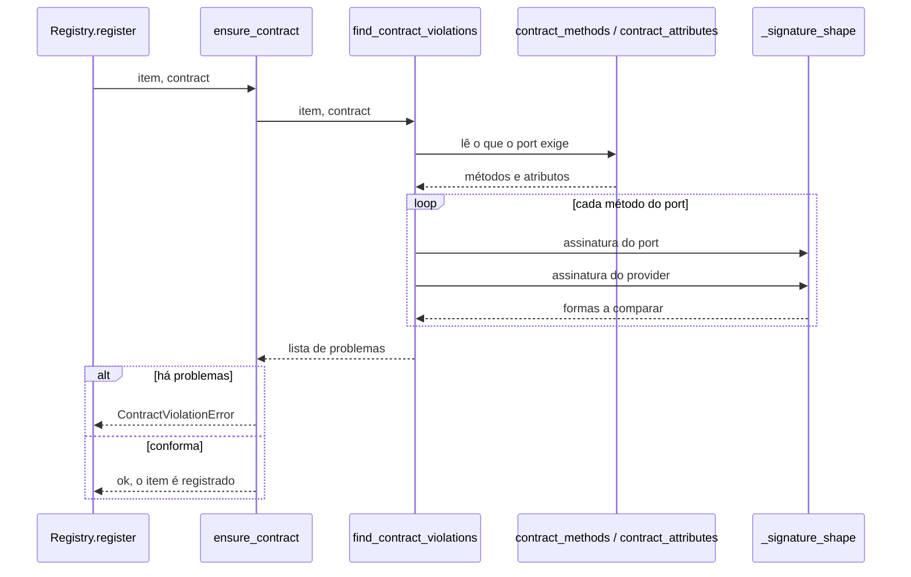

# Contratos

Um **contrato** é o conjunto de atributos e métodos que um [port](ports.md) exige de um [provider](providers.md). Aqui os contratos são escritos como `typing.Protocol`.

## Como o contrato é imposto

Um provider **não pode** ser implementado com método faltando ou assinatura diferente. Há três camadas de proteção, da mais cedo para a mais tarde:

| # | Camada | Quando age | O que pega |
|---|---|---|---|
| 1 | **mypy** (`mypy` na raiz) | Antes de rodar, no editor ou na CI | Método faltando, tipos incompatíveis. |
| 2 | **Herança explícita + `@abstractmethod`** | Ao instanciar a classe | Método faltando: `TypeError: Can't instantiate abstract class`. |
| 3 | **Validação no `Registry.register`** | Ao registrar o provider (na inicialização) | Atributos ausentes ou vazios, métodos ausentes e **assinaturas diferentes**. Lança `ContractViolationError`. |

Como `register_defaults()` roda quando `bootstrap` é importado, um provider inválido **derruba a aplicação na inicialização**, e não no meio de um job.

### 1. Herança explícita e `@abstractmethod`

Os ports são `Protocol`, e os providers herdam deles de forma explícita:

```python
class GitHubProjectProvider(ProjectProvider): ...
class BaseSubprocessCliProvider(CliModelProvider): ...   # as 4 CLIs herdam desta
```

Todos os métodos dos ports são `@abstractmethod`. Se o provider não implementar um deles, a classe não pode ser instanciada. A herança também deixa visível, na própria classe, qual contrato ela cumpre.

### 2. Validação no registro

`Registry` recebe o contrato na criação (veja [bootstrap.py](../src/pipeline/bootstrap.py)):

```python
project_registry = Registry[ProjectProvider]("ProjectProviders", contract=ProjectProvider)
```

Em `register()`, [contract.py](../src/pipeline/domain/contract.py) compara o provider com o port:

| Verificação | Falha quando |
|---|---|
| Atributos (`provider_key`, `display_name`, `binary_name`) | Não existem ou são strings vazias. |
| Métodos | Não existem ou não são chamáveis. |
| Parâmetros | Nome, ordem, tipo de parâmetro (posicional/nomeado), presença de valor padrão ou anotação de tipo diferentes. |
| Retorno | Anotação de retorno diferente. |

A validação **não depende de herança**: qualquer objeto que conforme com o port é aceito, e qualquer um que não conforme é recusado. Por isso a checagem vale também para classes que esqueceram de herdar.

A mensagem de erro lista todos os problemas de uma vez:

```
ContractViolationError: 'NoWriter' não cumpre o contrato 'ProjectProvider':
método 'move_card' ausente; método 'add_comment' ausente.
```

> [!IMPORTANT]
> As anotações de tipo precisam ser **iguais** às do port. Um método sem anotações, ou com um tipo diferente (`markdown: int`), é recusado.

### 3. mypy

A configuração está em `[tool.mypy]` no [pyproject.toml](../pyproject.toml). Para rodar:

```bash
pip install -e ".[dev]"
mypy
```

O mypy pega método faltando em tempo de edição. **Nomes de parâmetros diferentes não são acusados por ele por padrão**, e é a validação do registro que cobre esse caso.

## Limites que sobram

| Limite | Consequência |
|---|---|
| A validação compara a **forma** da assinatura, não o comportamento. | Um `fetch_cards` que devolve lista errada em tempo de execução não é detectado. |
| O mypy só cobre os módulos listados em `[tool.mypy]`. | Um provider criado fora dessas pastas precisa ser incluído na lista. |
| O registry global aceita qualquer provider que cumpra o contrato. | Isso inclui os fakes dos testes, que também herdam dos ports. |

## Funções de `contract.py`

Em [contract.py](../src/pipeline/domain/contract.py). As funções com `_` no início são internas e só são chamadas dentro do próprio arquivo.

| Função | Função (o que faz) | Onde é usada |
|---|---|---|
| `ensure_contract(item, contract)` | Ponto de entrada. Valida o item contra o port e lança `ContractViolationError` com todos os problemas encontrados. Não devolve nada quando o item conforma. | [`Registry.register`](../src/pipeline/domain/registry.py), em `registry.py`, antes de guardar o item. Os testes a exercitam indiretamente ao registrar providers. |
| `find_contract_violations(item, contract)` | Compara o item com o port e devolve a lista de problemas, vazia se conforma. Não lança erro. | Só dentro de `ensure_contract`. Pode ser chamada direto, por exemplo para mostrar os problemas sem interromper o fluxo. |
| `contract_methods(contract)` | Lista os métodos públicos que o port exige, incluindo os dos ports que ele estende (`ProjectProvider` junta `Reader` e `Writer`). | Dentro de `find_contract_violations`, para saber quais métodos conferir. |
| `contract_attributes(contract)` | Lista os atributos que o port declara (`provider_key`, `display_name`, `binary_name`). | Dentro de `find_contract_violations`, para saber quais atributos conferir. |
| `_contract_classes(contract)` | Devolve a cadeia de herança do port, sem `typing`, `abc` e `object`, para só considerar as classes do projeto. | Dentro de `contract_methods` e `contract_attributes`. |
| `_signature_shape(func)` | Extrai a "forma" da assinatura: para cada parâmetro, nome, tipo de parâmetro (posicional ou nomeado), se tem valor padrão e a anotação de tipo, mais o tipo de retorno. | Dentro de `find_contract_violations`, uma vez para o port e outra para o provider. As duas formas são comparadas. |
| `_describe(func)` | Monta o texto da assinatura (por exemplo `fetch_cards(project_key: str, ...)`) para a mensagem de erro. | Dentro de `find_contract_violations`, ao montar a mensagem "esperado ..., encontrado ...". |

### Ordem de chamada



## Dados que atravessam o contrato

Os contratos trocam objetos de valor definidos em [entities.py](../src/pipeline/domain/entities.py) (veja [entities.md](entities.md)):

| Objeto | Usado em |
|---|---|
| `CliPromptRequest` e `CliPromptResult` | `execute_prompt` |
| `ModelOption` | `list_models` |
| `RemoteCard` | `fetch_cards` |
| `BoardInfo` | `test_connection` |
| `SettingFieldSpec` | `settings_fields` |

## Erros do contrato

Os providers devem traduzir falhas de bibliotecas para exceções de domínio, usando `raise ... from e`:

- CLIs: `ProviderNotInstalledError` e `ProviderExecutionError`.
- Quadros: `BoardError`.

Veja [exceptions.md](exceptions.md).
