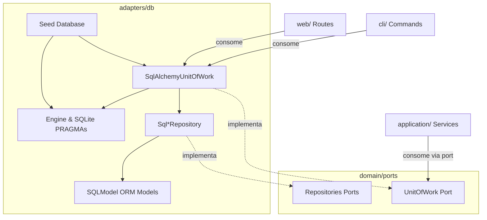

# Camada de Persistência e Banco de Dados (`adapters/db`)

Localizada em [src/pipeline/adapters/db](../../src/pipeline/adapters/db). Fornece a persistência relacional do pipeline utilizando **SQLModel** e **SQLAlchemy**, operando de forma isolada como um adaptador de saída (*outbound adapter*).

## Arquitetura da Camada

## Módulos Documentados

| Documento | Arquivo no Código | Descrição Principal |
|---|---|---|
| [engine.md](engine.md) | `engine.py` | Criação da engine, configurações de concorrência (`WAL`), chaves estrangeiras SQLite e ciclo de vida de conexões. |
| [orm_models.md](orm_models.md) | `orm_models.py` | Schema das 9 tabelas do banco de dados, chaves primárias, relacionamentos (FKs), colunas JSON e índices. |
| [repositories.md](repositories.md) | `repositories.py` | Implementações dos 9 repositórios concretos SQL, métodos CRUD, queries executadas e onde são consumidos no código. |
| [uow.md](uow.md) | `uow.py` | Gerenciamento de transações atômicas com `SqlAlchemyUnitOfWork`, context manager (`with uow:`), commit/rollback e injeção de dependência. |
| [seed.md](seed.md) | `seed.py` | Povoamento inicial idempotente: configurações do sistema, agente padrão ("Arquiteto Gemini") e colunas do Kanban. |
