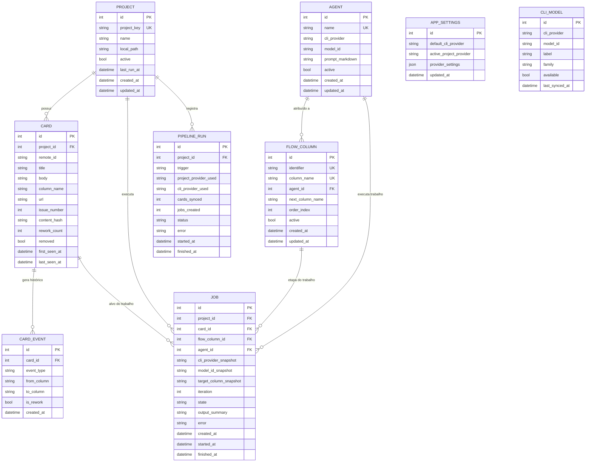

# Modelos ORM (Tabelas do Banco de Dados)

Definido em [orm_models.py](../../src/pipeline/adapters/db/orm_models.py). Contém as classes que mapeiam as tabelas relacionais do banco via **SQLModel** (que une SQLAlchemy e Pydantic).

> Para a visão dos objetos de valor de domínio imutáveis, consulte também [entities.md](../entities.md).

## Diagrama Entidade-Relacionamento (ER)

## Detalhamento das Tabelas

### 1. `AppSettings` (`app_settings`)
Registro único (`id=1`) que armazena a configuração operacional global do sistema.
- `default_cli_provider`: Provedor padrão de CLI de IA (`agy`, `gemini`, `claude`, `codex`).
- `active_project_provider`: Provedor ativo de quadro (`github`, `jira`, `trello`).
- `provider_settings`: Coluna `JSON` que guarda tokens, credenciais e parâmetros específicos de cada provedor externo de projeto.

### 2. `CliModel` (`cli_models`)
Catálogo sincronizado dos modelos de IA oferecidos por cada CLI instalada.
- Índices em `cli_provider` e `model_id`.
- `available`: Flag booleana que indica se o modelo continua ativo no provedor após o último sync.

### 3. `Agent` (`agents`)
Configuração de um agente autônomo de IA.
- `name`: Nome único do agente (indexado).
- `cli_provider` e `model_id`: Identificação da CLI e do modelo específico utilizado.
- `prompt_markdown`: Prompt de sistema / diretrizes operacionais do agente.

### 4. `Project` (`projects`)
Representa um projeto/repositório gerenciado pelo pipeline.
- `project_key`: Identificador único no provedor externo (ex: `owner/12` no GitHub ou chave no Jira/Trello).
- `local_path`: Caminho no sistema de arquivos local onde a CLI do agente executará as alterações.
- `last_run_at`: Timestamp da última sincronização realizada pelo orquestrador.

### 5. `FlowColumn` (`flow_columns`)
Mapeia o fluxo de trabalho (Kanban) e associa colunas a agentes de IA.
- `column_name`: Nome exato da coluna no quadro externo.
- `agent_id`: FK opcional para `agents.id`. Se preenchido, cards nesta coluna disparam jobs com este agente.
- `next_column_name`: Coluna de destino sugerida para avanço automático pós-processamento.
- `order_index`: Posição ordinal para ordenação das colunas no fluxo.

### 6. `Card` (`cards`)
Espelho persistido de um card/issue externo do quadro.
- `project_id`: FK para `projects.id`.
- `remote_id`: Identificador original no provedor externo.
- `content_hash`: Hash SHA-256 do título + corpo para detectar alterações no conteúdo do card.
- `rework_count`: Contador incrementado quando um card retorna para uma coluna anterior no fluxo.
- `removed`: Flag que indica se o card foi deletado ou movido para fora do escopo no quadro remoto.

### 7. `CardEvent` (`card_events`)
Trilha de auditoria e métricas de movimentação dos cards.
- `event_type`: Tipo de ocorrência (`created`, `column_changed`, `content_changed`, `removed`).
- `from_column` e `to_column`: Transição de colunas.
- `is_rework`: Indica se o evento representou retrabalho.

### 8. `Job` (`jobs`)
Unidade de trabalho atômica gerada quando um card entra em uma coluna assistida por agente.
- `state`: Estado da execução (`pending`, `running`, `succeeded`, `failed`, `cancelled`).
- Snapshots (`cli_provider_snapshot`, `model_id_snapshot`, `target_column_snapshot`): Preservam a configuração do momento da criação do job, prevenindo inconsistências caso o agente ou coluna sejam editados depois.
- `output_summary` e `error`: Resumo do resultado retornado pela CLI ou stack trace em caso de falha.

### 9. `PipelineRun` (`pipeline_runs`)
Histórico de execuções do ciclo do orquestrador.
- `trigger`: Gatilho disparador (`web_project`, `web_all`, `cli`).
- `cards_synced` e `jobs_created`: Métricas quantitativas da execução.
- `status`: Resultado global (`ok`, `partial`, `error`).
