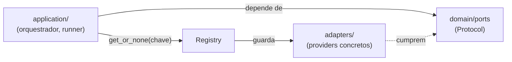
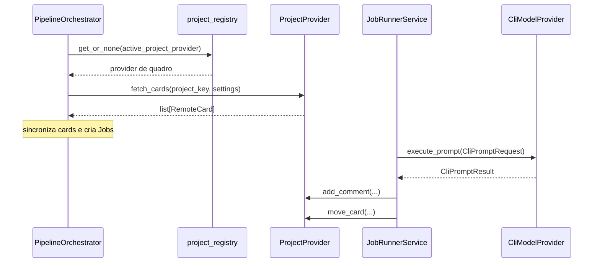

# Ports

Um **port** é a interface que o núcleo do sistema espera de algo externo. Os ports ficam em [domain/ports](../src/pipeline/domain/ports/). As classes que os cumprem são os [providers](providers.md), e a forma como o cumprimento é definido está em [contracts.md](contracts.md).



O núcleo depende só do port. Os providers herdam do port, e o `Registry` valida o cumprimento do contrato ao registrá-los (veja [contracts.md](contracts.md)).

## Ports existentes

| Arquivo | Port | Tipo |
|---|---|---|
| [cli_provider.py](../src/pipeline/domain/ports/cli_provider.py) | `CliModelProvider` | Provider de CLI de IA |
| [project_provider.py](../src/pipeline/domain/ports/project_provider.py) | `ProjectBoardReader`, `ProjectBoardWriter`, `ProjectProvider` | Provider de quadro de projeto |
| [repositories.py](../src/pipeline/domain/ports/repositories.py) | `SettingsRepository`, `AgentRepository`, `ProjectRepository`, `FlowColumnRepository`, `JobRepository`, `CardRepository` e outros | Acesso a dados |
| [uow.py](../src/pipeline/domain/ports/uow.py) | `UnitOfWork` | Transação que agrupa os repositórios |

Este documento detalha os dois ports de provider. Os ports de repositório e de `UnitOfWork` só aparecem na tabela.

## `CliModelProvider`

| Membro | Tipo | Função |
|---|---|---|
| `provider_key` | atributo | Chave única, usada no registry e gravada no banco (ex.: `"claude"`). |
| `display_name` | atributo | Nome mostrado na interface. |
| `binary_name` | atributo | Nome do executável procurado no PATH. |
| `is_installed()` | método | Indica se o binário existe. |
| `list_models()` | método | Devolve `list[ModelOption]` com os modelos da CLI. |
| `execute_prompt(req)` | método | Recebe um `CliPromptRequest` e devolve um `CliPromptResult`. |

**Quem chama:** `JobRunnerService` (`execute_prompt`) e `ModelCatalogService` (`list_models`, `is_installed`).

## `ProjectProvider`

União de duas interfaces menores:

```
ProjectProvider
├── ProjectBoardReader   (leitura)
└── ProjectBoardWriter   (escrita)
```

**`ProjectBoardReader`**

| Membro | Função |
|---|---|
| `provider_key`, `display_name` | Identificação, como na CLI. |
| `settings_fields()` | Devolve `list[SettingFieldSpec]` com os campos de configuração exigidos (token, e-mail, etc.). |
| `test_connection(project_key, settings)` | Valida a conexão e devolve um `BoardInfo`. |
| `fetch_cards(project_key, settings)` | Devolve `list[RemoteCard]` com os cards do quadro. |

**`ProjectBoardWriter`**

| Membro | Função |
|---|---|
| `move_card(project_key, remote_card_id, target_column_name, settings)` | Move o card para outra coluna. |
| `add_comment(project_key, remote_card_id, markdown, settings)` | Comenta no card. |

**Quem chama:** `PipelineOrchestrator` (`fetch_cards`) e `JobRunnerService` (`add_comment` e `move_card`).

## Fluxo de uma execução


