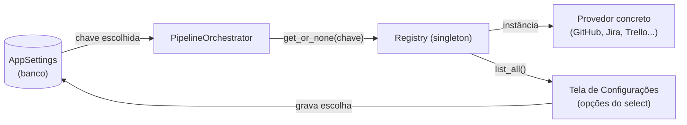

# Registry

Definido em [registry.py](../src/pipeline/domain/registry.py). É um contêiner genérico em memória (`Registry[T]`) que guarda componentes plugáveis por chave. Permite adicionar novos provedores sem alterar o código que os usa (princípio aberto/fechado do SOLID).

## API

| Método | Função |
|---|---|
| `register(item, key=None)` | Registra o item. Se `key` não for informada, usa o atributo `provider_key` do item. Lança `ValueError` se não houver chave. Se o registry tem um `contract`, valida o item contra o port e lança `ContractViolationError` quando ele não cumpre (veja [contracts.md](contracts.md)). Registrar a mesma chave de novo **sobrescreve** o item anterior. |
| `Registry(name, contract=None)` | Construtor. Com `contract`, todo item registrado é validado contra esse port. |
| `get(key)` | Retorna o item. Lança `KeyError` se a chave não existir. |
| `get_or_none(key)` | Retorna o item ou `None`. |
| `has(key)` | Indica se a chave existe. |
| `list_keys()` | Lista as chaves registradas. |
| `list_all()` | Lista os itens registrados. |
| `clear()` | Remove todos os itens. |

> O `Registry` lança as exceções nativas `ValueError` e `KeyError`, e não as de `DomainError`. Por isso, `except DomainError` não captura os erros do registry.

## Instâncias globais

Criadas em [bootstrap.py](../src/pipeline/bootstrap.py):

| Registry | Tipo | Chaves padrão |
|---|---|---|
| `cli_registry` | `Registry[CliModelProvider]` (contrato `CliModelProvider`) | `agy`, `gemini`, `claude`, `codex` |
| `project_registry` | `Registry[ProjectProvider]` (contrato `ProjectProvider`) | `github`, `jira`, `trello` |

`register_defaults()` registra os provedores padrão e é chamada automaticamente quando o módulo é importado.

## Como é usado

- `PipelineOrchestrator` busca o provedor de quadro ativo com `project_registry.get_or_none(...)` e lança `BoardError` se não existir.
- `JobRunnerService` e `ModelCatalogService` resolvem a CLI de IA por `cli_registry`.

## Visão geral: banco, registry e Strategy

O registry é a base do padrão **Strategy** do projeto. O banco guarda a *escolha*, e o registry guarda as *opções* disponíveis.

| Papel | Onde fica | Conteúdo |
|---|---|---|
| Escolha do usuário | Banco, modelo `AppSettings` | `default_cli_provider`, `active_project_provider` e credenciais (`provider_settings`, JSON). |
| Opções disponíveis | `cli_registry` e `project_registry` (memória) | Instâncias dos provedores, indexadas por `provider_key`. |
| Contrato | `Protocol` em [ports](../src/pipeline/domain/ports/) | `CliModelProvider`, `ProjectProvider` (`ProjectBoardReader`/`Writer`). |
| Implementações | [adapters](../src/pipeline/adapters/) | Classes concretas (GitHub, Jira, Trello, agy, claude, codex, gemini). |



**Fluxo:**

1. Na tela de Configurações, a rota [settings.py](../src/pipeline/web/routes/settings.py) monta as opções com `cli_registry.list_all()` e `project_registry.list_all()`, lendo `provider_key` e `display_name` de cada provedor.
2. O usuário escolhe e o valor é gravado em `AppSettings`.
3. Na execução, o orquestrador lê a chave no banco, pega o provedor no registry e chama o método do contrato (por exemplo `fetch_cards`) sem saber qual implementação recebeu.

**O registry é um singleton de módulo.** `cli_registry` e `project_registry` são criados em [bootstrap.py](../src/pipeline/bootstrap.py) e compartilhados por todos que os importam. Eles funcionam como a fábrica que escolhe a estratégia.

> [!NOTE]
> **O contrato é um `Protocol`, não uma classe-pai.** Provedores como `GitHubProjectProvider` não herdam de nada. Valem como provedor por terem os métodos e atributos exigidos (duck typing). A única herança é interna aos adapters de CLI: `BaseSubprocessCliProvider` ([base.py](../src/pipeline/adapters/cli_providers/base.py)) reaproveita a execução de subprocesso, e `ClaudeCliProvider` herda dela. Isso é reuso de código, e o registry não depende dessa herança.

> [!WARNING]
> **Limitação atual: os campos de credenciais não vêm do registry.** O `POST /settings` tem os campos escritos no código (`github_token`, `jira_email`, `trello_token` e assim por diante), com um `if` para cada um. Os provedores já expõem `settings_fields()` (que devolve `SettingFieldSpec`) para gerar o formulário dinamicamente, mas a rota não o usa. Por isso, um provedor novo aparece na lista de opções só com o registro, mas o formulário de suas credenciais ainda exige editar a rota. O template `settings/form.html` não foi verificado e pode ter o mesmo problema.

## Onde o registry é usado

| Arquivo | Chamada | Para quê |
|---|---|---|
| [pipeline_orchestrator.py](../src/pipeline/application/pipeline_orchestrator.py#L32) | `project_registry.get_or_none` | Pega o provedor de quadro ativo e chama `fetch_cards`. |
| [job_runner_service.py](../src/pipeline/application/job_runner_service.py#L77) | `cli_registry.get_or_none` | Pega a CLI de IA que executa o job. |
| [job_runner_service.py](../src/pipeline/application/job_runner_service.py#L109) | `project_registry.get_or_none` | Pega o provedor de quadro ativo para comentar no card (`add_comment`) e movê-lo (`move_card`) após o job. |
| [model_catalog_service.py](../src/pipeline/application/model_catalog_service.py#L14) | `get_or_none` e `list_all` | Sincroniza o catálogo de modelos de uma CLI, ou de todas as instaladas. |
| [web/routes/agents.py](../src/pipeline/web/routes/agents.py#L49) | `cli_registry.list_all` | Lista as CLIs no formulário de agentes (linhas 49 e 101). |
| [web/routes/projects.py](../src/pipeline/web/routes/projects.py#L44) | `project_registry.get_or_none` | Mostra o nome do provedor ativo (`display_name`) no formulário de projeto (linhas 44 e 97). |
| [web/routes/settings.py](../src/pipeline/web/routes/settings.py#L25) | `list_all` | Monta as opções da tela de Configurações (linhas 25 e 30). |
| [cli.py](../src/pipeline/cli.py#L11) | só o `import` | Importa os registries, sem chamá-los. A importação de `bootstrap` executa `register_defaults()`. |
| [tests/test_pipeline_orchestrator.py](../tests/test_pipeline_orchestrator.py#L28) | `register` | Registra *fakes* de CLI e de quadro nos testes (linhas 28 e 35). |

Padrões de uso:

- **Strategy** (`get_or_none` e depois chamar o método do provedor): orquestrador, runner de jobs e catálogo de modelos.
- **Listagem ou nome para a interface** (`list_all`, `display_name`): rotas de agentes, projetos e configurações.
- **Testes** (`register` com um fake): troca a estratégia real por uma falsa sem mexer no código de produção.

## Adicionar um novo provedor

1. Crie a classe do provedor, com `provider_key` e `display_name`, implementando a porta correspondente em [ports](../src/pipeline/domain/ports/).
2. Registre-a em `register_defaults()` em [bootstrap.py](../src/pipeline/bootstrap.py):

```python
cli_registry.register(MeuCliProvider())
```
